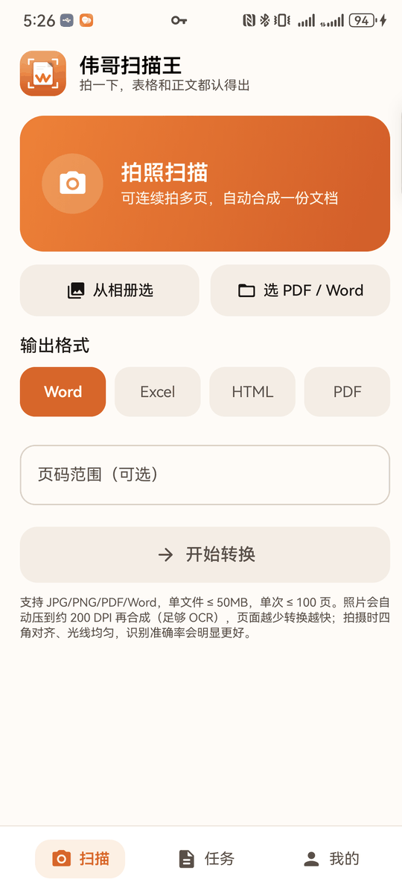

# 伟哥扫描王

拍照 / 图片 / PDF / Word → **可编辑的 Word、Excel、HTML、PDF**。原生 Android 客户端，后端复用现有 Web 服务。

**[下载 APK](dist/WeigeScan-1.0.4-release.apk)**（1.7 MB，Android 8.0+ / API 26，已签名） · [Release 说明](https://github.com/qilin892/weige-scan-android/releases)



## 功能

- **拍照连拍**：多页自动合成一份 PDF 再上传，产物是一整篇文档而不是一堆碎片
- **三种输入**：相机 / 相册多选 / PDF、Word 文件
- **四种输出**：Word、Excel、HTML、PDF，可指定页码范围
- **后台不中断**：上传与转换跑在前台服务里，锁屏、切微信都不会断，通知栏看进度
- **预览与导出**：带水印预览前 3 页，一键保存到「下载/伟哥扫描王」或直接分享
- **两种模式**：免费通道（产物一出来就能下载）/ 授权码模式；支持深色模式

## 截图

| 扫描 | 任务 | 预览 |
| -- | -- | -- |
|    |    |    |

| 我的 | 登录 |
| -- | -- |
|    |    |

> 真机截图（华为 BRA-AL00 / Android 12），已压缩到 540px 宽。

## 技术栈

| 项                               | 版本                                                                    |
| ------------------------------- | --------------------------------------------------------------------- |
| Kotlin / AGP / Gradle           | 2.0.21 / 8.5.2 / 8.8                                                  |
| compileSdk / targetSdk / minSdk | 35 / 35 / 26                                                          |
| UI                              | Jetpack Compose（BOM 2024.09.03 + Material3），单 Activity，无 Navigation 库 |
| 网络                              | OkHttp 4.12（会话 Cookie + 带进度的 multipart 上传）                            |
| 其它                              | coroutines 1.8.1、Coil 2.6、exifinterface                               |
| 打包                              | release 开 R8 + 资源压缩，产物 1.7 MB                                         |

## 架构

```
Compose UI  ──►  AppViewModel（mutableStateOf）
                    │ 提交
                    ▼
             ConvertService（前台服务 dataSync）
               · 上传（ProgressBody）
               · 每 2s 轮询任务状态，刷通知
                    │ 写
                    ▼
             TaskStore（StateFlow<List<TaskItem>>）──► UI 订阅
```

长任务放在服务里而不是 ViewModel：一次转换几十秒到几分钟，切后台会被系统掐掉。

## 构建

```bash
export JAVA_HOME=/path/to/jdk17
./gradlew assembleDebug     # 调试包
./gradlew assembleRelease   # 正式包（R8 + 签名）
```

- `local.properties` 指向本机 Android SDK
- 签名读 `keystore.properties` + `keystore/*.jks`（都不入库）；没有该文件时只出 debug 包
- 服务端地址在 `app/build.gradle.kts` 的 `BASE_URL`

## 说明

- 接口契约、踩坑记录、版本变更见 [docs/DEV-NOTES.md](docs/DEV-NOTES.md)
- 产物在服务端保留 24 小时，请及时保存
- 登录用与网页版相同的账号密码
